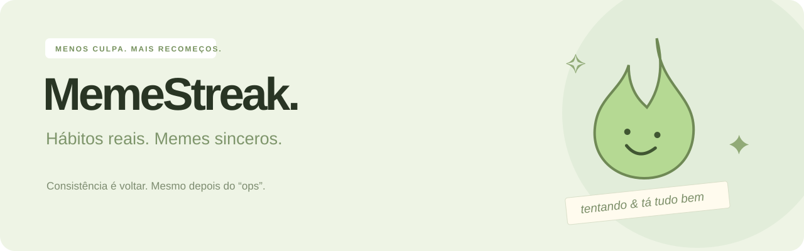

<div align="center">



# Um recomeço de cada vez. 🌱

**Um rastreador de hábitos para gente de verdade.**  
Celebre os dias em que você aparece. Nos outros, receba um meme — e uma nova chance.


[Experiência](#-a-experiência) · [Funcionalidades](#-o-que-já-funciona) · [Rodar localmente](#-rodar-localmente) · [Arquitetura](#-por-dentro-do-projeto)

</div>

## 🩹 Memestreak-1.1

Atualização de correção que restaura os módulos, recursos visuais, configurações e testes ausentes no envio anterior. A verificação de tipos agora identifica arquivos faltantes e prepara as declarações do Next.js antes da análise. Hábitos e backups anteriores permanecem compatíveis. Veja o [histórico de alterações](CHANGELOG.md).

## 💭 A ideia

Quebrar uma sequência não deveria significar desistir de um hábito. Muitos aplicativos tornam o tropeço a parte mais visível da experiência. O **MemeStreak** transforma esse momento em um convite para voltar: um meme aleatório, uma frase gentil e o seu progresso ainda ali.

> **A sequência pode mudar. O que você já conquistou continua com você.**

A versão **1.1.0 é um MVP funcional e local**, sem cadastro, chaves de API ou serviços obrigatórios. Não há backend, login, banco remoto, sincronização entre dispositivos nem ranking público nesta versão. Favoritos e votos são pessoais.

## ✨ A experiência

| Espaço               | O que você encontra                                                                                      |
| :------------------- | :------------------------------------------------------------------------------------------------------- |
| **Meu dia**          | Hábitos programados, botão “Fiz hoje”, opção “Pulei”, sequência e progresso da meta.                     |
| **Calendário**       | Histórico mensal por hábito; toque em um dia para registrar, corrigir ou desfazer.                       |
| **Galeria de memes** | Oito memes de texto e emojis, filtros, favoritos, votos e criação de memes pessoais com imagem opcional. |
| **Meu progresso**    | Dias cumpridos, recordes e consistência, com resultados por hábito.                                      |
| **Preferências**     | Modo sem julgamento, backups e gerenciamento de hábitos ativos ou arquivados.                            |

O visual combina verde suave, cartões claros e mensagens leves. A navegação lateral vira uma barra inferior no celular. Os diálogos têm controle de foco, fechamento por teclado e rótulos acessíveis.

## 🧩 O que já funciona

- **Rotinas flexíveis:** nome, ícone, dias da semana e meta de 1 a 365 dias programados.
- **Registro sem atrito:** concluir, pular e desfazer; um único registro por hábito/dia.
- **Histórico corrigível:** dias anteriores podem ser ajustados no calendário, desde a criação do hábito.
- **Sequência real:** folgas e períodos arquivados não entram na contagem nem quebram a sequência.
- **Memes de recomeço:** sorteio ao pular e detecção de quebra ao retornar depois de um dia programado sem registro.
- **Galeria pessoal:** favoritar, votar uma vez por meme, retirar o voto e ordenar pelos seus votos.
- **Criação de memes:** textos próprios ou imagem PNG/JPEG/WebP, reduzida no navegador.
- **Modo sem julgamento:** ativo por padrão, oculta o total de dias não cumpridos nas estatísticas.
- **Backup JSON:** exportação, importação validada e confirmação antes de substituir os dados.
- **Persistência local:** recarregar a página preserva o progresso; alterações de outras abas são recebidas pelo evento de armazenamento.
- **Recuperação cautelosa:** dados inválidos não são substituídos silenciosamente; o arquivo original pode ser exportado.

## 🔥 Como a sequência é calculada

**Um dia de sequência representa um dia programado cumprido.** Para uma rotina de segunda, quarta e sexta, concluir os três dias resulta em uma sequência de 3.

| Situação                               | Comportamento                                                      |
| :------------------------------------- | :----------------------------------------------------------------- |
| Hoje ainda não foi registrado          | A sequência anterior permanece até o dia acabar.                   |
| Um dia programado anterior ficou vazio | A sequência reinicia; ao abrir o app, aparece um meme de recomeço. |
| Você marca “Pulei”                     | A quebra é imediata e um meme aparece.                             |
| Dia de folga                           | Não soma, não reduz a consistência e não quebra a sequência.       |
| Hábito arquivado                       | O acompanhamento pausa; o histórico permanece disponível.          |
| Correção de um registro                | Sequências, recordes e estatísticas são recalculados.              |
| Meta alcançada                         | A barra chega a 100%; a sequência pode continuar crescendo.        |

Uma interrupção longa gera um único evento de quebra por sequência encerrada. Se houver várias quebras ainda não vistas, um único meme acolhe o retorno. Ao corrigir o histórico, eventos antigos já vistos não são reapresentados.

**Consistência = dias cumpridos ÷ oportunidades encerradas × 100.** Hoje só entra no denominador quando você registra “Fiz” ou “Pulei”. O total geral soma conclusões por hábito: dois hábitos feitos no mesmo dia contam como duas vitórias.

As datas seguem o calendário e o fuso local do dispositivo. O aplicativo verifica a virada do dia a cada 30 segundos e quando a janela recupera o foco. A frequência fica bloqueada depois do primeiro registro para evitar que uma edição reescreva o significado do histórico; nome, ícone e meta continuam editáveis.

## 🚀 Rodar localmente

Requisitos: **Node.js 22.22.2+, 24.15.0+ ou 26+** e npm.

```bash
npm ci
npm run dev
```

Abra **http://localhost:3000**. A primeira execução começa vazia, pronta para seus hábitos reais.

```bash
# Compilar e executar a versão de produção
npm run build
npm start
```

Não é necessário criar um arquivo `.env`. O projeto usa o fluxo padrão do Next.js e é compatível com hospedagem que suporte esse framework, incluindo Vercel. Este pacote não publica nem cria serviços automaticamente.

## 🧪 Qualidade

```bash
npm run typecheck
npm test
npm run test:ui

# Testes de ponta a ponta, com navegador instalado
npx playwright install chromium
npm run build
npm run test:e2e
```

- **Motor de hábitos:** folgas, pausas, quebras, correções, datas futuras, ano bissexto, fronteiras de calendário e validação dos backups.
- **Interface em DOM simulado:** cadastro, conclusão, retorno, modo sem julgamento e recuperação de dados.
- **Playwright:** fluxos de hábito e galeria em projetos desktop e mobile.

A execução do Playwright requer um ambiente que permita iniciar o Chromium. Para um navegador já instalado, a configuração aceita `PLAYWRIGHT_CHROMIUM_EXECUTABLE_PATH`. Consulte [VALIDATION.md](docs/VALIDATION.md) para os resultados da entrega.

## 🛠 Por dentro do projeto

| Camada       | Tecnologia / responsabilidade                                                       |
| :----------- | :---------------------------------------------------------------------------------- |
| Aplicação    | Next.js App Router + React + TypeScript estrito                                     |
| Estilos      | Tailwind CSS 4 + CSS responsivo próprio                                             |
| Componentes  | Button e Dialog locais no padrão shadcn/ui, com Radix UI, CVA e composição por Slot |
| Ícones       | Lucide React                                                                        |
| Regras       | Funções puras em `lib/engine.ts`                                                    |
| Validação    | Zod, com versão explícita do formato de backup                                      |
| Persistência | `localStorage`, chave `memestreak:v1`                                               |
| Testes       | Node Test Runner, Testing Library, JSDOM e Playwright                               |

| Diretório       | Conteúdo                                            |
| :-------------- | :-------------------------------------------------- |
| `app/`          | Página, metadados e estilos globais                 |
| `components/`   | Interface e componentes reutilizáveis               |
| `lib/engine.ts` | Datas, agenda, sequências, pausas e registros       |
| `lib/store.ts`  | Esquemas de dados, catálogo de memes e persistência |
| `tests/`        | Testes unitários, de interface e ponta a ponta      |
| `public/`       | Ícone do projeto                                    |
| `docs/`         | Identidade visual, arquitetura e validação          |

Veja [ARCHITECTURE.md](docs/ARCHITECTURE.md) para decisões técnicas e a evolução planejada.

## 🔐 Dados e limites desta versão

Os dados ficam no navegador, associados à origem do site. Mudar domínio, navegador ou dispositivo não transfere os dados automaticamente; use **Exportar backup** e **Restaurar backup**. O JSON contém seus hábitos e imagens: guarde-o como arquivo pessoal.

- Até **100 hábitos** e **100 memes pessoais**.
- Imagens de entrada de até **2 MB**, reduzidas para até 640 px no maior lado.
- Backup e estado serializado limitados a aproximadamente **4 MB**; o navegador pode impor uma quota menor.
- Sem service worker: não há garantia de carregamento offline ou instalação como PWA.
- Abas recebem as alterações umas das outras; edições simultâneas seguem a última gravação, sem resolução de conflitos.
- Memes incluídos usam textos próprios e emojis renderizados pelo sistema. A aparência dos emojis varia entre dispositivos.
- Use imagens próprias ou com permissão ao adicionar conteúdo à galeria.

## 🌱 Próximos capítulos

- [ ] Autenticação e sincronização entre dispositivos com Supabase/PostgreSQL.
- [ ] Políticas RLS, migrações e testes de isolamento por usuário.
- [ ] Galeria comunitária com moderação e votação no servidor.
- [ ] PWA e lembretes opcionais.
- [ ] Histórico de mudanças de frequência, temas e conquistas.

## 🤝 Contribuições

Melhorias são bem-vindas, principalmente em acessibilidade, testes de calendário e mensagens que acolham sem infantilizar. Antes de propor uma mudança, descreva o problema, o comportamento esperado e como reproduzi-lo. Preserve a ideia central: **humor sem humilhação; constância sem culpa**.

## 📄 Licença

Código distribuído sob a [licença MIT](LICENSE). Imagens adicionadas pelos usuários permanecem sujeitas às permissões dos seus respectivos titulares.

<div align="center">

**Você não precisa ser perfeito. Só precisa poder recomeçar.**

</div>
